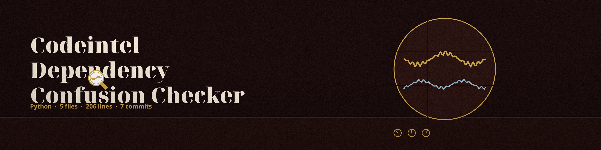

# codeintel-Dependency-Confusion-Checker
Identifies potential dependency confusion attacks by checking for inconsistencies between locally installed packages and those available in public repositories. - Focused on Tools for static code analysis, vulnerability scanning, and code quality assurance

Every run prints a closing summary with checked, failed, and not found counts. The run exits 1 when any check failed or no package could be listed at all. The line saying no potential vulnerabilities were found is printed only for a run whose checks completed. In single package mode (-p), the named package is looked up in the installed set and flagged on the same rule as a full run. Packages absent from the public index are printed as a named result class, Packages not found on the public index, not only as a log line.

## Install
`git clone https://github.com/ShadowGuardAI/codeintel-dependency-confusion-checker`

## Usage
`./codeintel-dependency-confusion-checker [params]`

## Parameters
- `-h`: Show help message and exit
- `-p`: The name of the package to check (e.g., 
- `-r`: No description provided
- `-v`: Enable verbose output for debugging.

## License
Copyright (c) ShadowGuardAI
